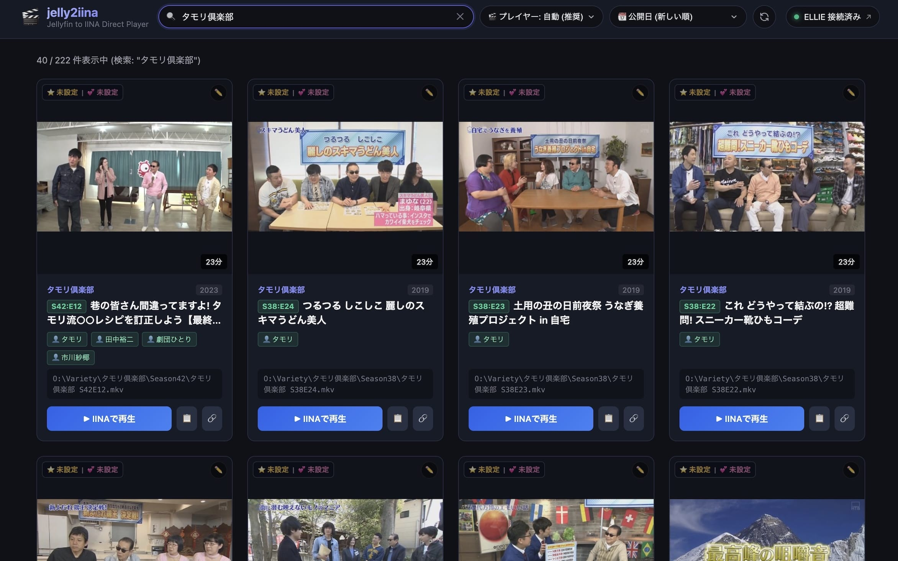

# jelly2iina (Jellyfin to IINA / MPV Direct Player)

個人用なので検索ロジックはあまり良いとは言えません。また、ローカル使用前提で認証は行わない仕様です。

Jellyfinサーバー上のメディアをブラウザからメタデータ横断検索し、**Mac上のIINA（`iina://` URIスキーム）やWindows上のMPV（`mpv-handler://` URIスキーム）でダイレクト再生**するための軽量Webブリッジアプリケーションです。



> [!NOTE]
> **ローカルパス直再生の前提条件**:
> ローカルファイル直接再生（IINA / MPV）を利用する場合、**Jellyfinサーバーと再生クライアントPCの間で同じメディアパス（マウントポイントやネットワークドライブ等）にアクセス可能であること**が前提となります（例: サーバー上の `/Volumes/Share/...` をMacクライアントでも同一の `/Volumes/Share/...` としてマウント、Windows同士ならドライブレターの一致）。
> パスが一致しない環境やマウントを行っていないクライアントからは、**Jellyfin Direct Stream（無変換HTTPストリーミング）** を使用することで一切のマウント設定不要でダイレクト再生が可能です。

---

## 🌟 主な特徴・機能

- ⚡ **サーバー＆クライアントOS完全自動適応・爆速ダイレクト再生**:
  - **Linux Jellyfin の場合**:
    - **Mac クライアント**: ローカルパスによる **IINA 直接再生**（`file:///...`、トランスコード不要・最高速）
    - **Windows クライアント**: マウント不要な **MPV Direct Stream 再生**（`mpv-handler://play/...`）
  - **Windows Jellyfin の場合**:
    - **Windows クライアント**: パス一致を活かした **MPV ローカル直接再生**（`mpv-handler://...`）
    - **Mac クライアント**: セパレータの違いを吸収する **IINA Direct Stream 再生**（`iina://weblink?url=http://...`）
  - **サーバーOS自動判別**: Jellyfinのシステム内部パスおよびメディアパスから、Linux/Windowsを完全自動検出。
  - **手動切替対応**: ヘッダーのセレクトで「自動」「MPV (Stream)」「MPV (ローカル)」「IINA (ローカル)」「IINA (Stream)」をいつでも選択可能。
  - **🔗 ストリームURLワンクリックコピー**: 任意の外部プレイヤーに渡せるHTTPストリームURL取得ボタン。
- 🔍 **横断メタデータ検索**:
  - **タイトル・ファイル名・概要文**の検索
  - **シリーズ名（親タイトル）検索**: シリーズ配下の全エピソード動画（`S1:E1` など）を自動展開
  - **出演者（Person）検索**: タイトルに名前のない出演作も部分一致で漏れなくヒット
  - **タグ（Tags）検索**: `#アニメ`, `#アクション`, `#SF`, `#ドラマ` などのタグによる横断ヒット
  - **スタジオ（Studios / メーカー）検索**: `A-1 Pictures`, `MAPPA`, `Warner Bros.` などのスタジオ名検索
- 🏷️ **インタラクティブUI**:
  - **ホームリセット（左上ロゴ）**: クリックで検索窓をクリアし、ページ最上部へスムーズスクロールして一覧を初期化。
  - **再読み込みボタン（🔄）**: 現在の検索ワード・ソート順を維持したまま、最上部へ移動して最新データを再取得。
  - **Jellyfin 直行リンク（右上ステータス）**: 接続状況（オンライン/オフライン）を確認でき、ワンクリックでJellyfin WebUIを別タブ表示。
  - **メタデータ編集モーダル**: 個人評価（💕 User Rating）およびコミュニティ評価（⭐ Rating）のスライダー・ワンタッププリセット（10点/9点/未設定等）、公開日（カレンダー選択・年号連動）、タイトル、タグ、概要を即座に更新・リアルタイム反映。
  - **評価バッジ（💕 / ⭐）または ✏️ ボタン**: 個人評価（💕）とコミュニティ評価（⭐）の両方を未設定ステータス含めて常時バッジ表示。クリックするだけでサクッと個人評価・コミュニティ評価を変更可能。
  - **タグバッジ（#タグ名）**: クリックするだけでそのタグの絞り込み検索を実行
  - **出演者バッジ（👤 出演者名）**: `Role: Actor` の出演者をカード上に一覧表示。クリックでその出演者の出演作を一発検索
  - **公開日未設定バッジ**: 公開日や制作年が未設定の動画に表示。クリックして直接編集モーダルを開いて日付を設定可能
  - **シリーズリンク**: クリックで同一シリーズの全話を一発表示
  - **スクエア比率サムネイル**: 縦長ポスターも横長サムネイルもアスペクト比を崩さずすっきり収容
  - **評価スコアバッジ**: 個人評価（💕）とコミュニティ評価（⭐）をカード上に視覚的に両方常時表示
- 📜 **無限スクロール（自動追加読み込み）**:
  - ページ最下部へスクロールするだけで、全メディア（数千件以上）をスムーズに自動読み込み。
- 🔀 **多彩な並び替え（ソート機能）**:
  - 📅 **公開日 (新しい順 [デフォルト] / 古い順)**: 未設定の作品は追加日時フォールバックで末尾に整然と配置
  - 🕒 **追加日 (新しい順 / 古い順)**
  - 💕 **個人評価 (高い順 / 低い順)**: JellyfinのUserData個人スコア基準
  - ⭐ **コミュニティ評価 (高い順 / 低い順)**
  - 📁 **ファイル名 (昇順 / 降順)**: 自然順ソート対応。シリーズエピソードを第1話〜最終話順に整然と並び替え
  - 🔤 **タイトル (A-Z / Z-A)**: 作品タイトル自体の自然順ソート
  - 🎲 **ランダム**
- 📋 **ワンクリック パスコピー**:
  - LAN内の非HTTPS環境（Vivaldi / Chrome / Safari）でも安全に動くフォールバック付きクリップボードコピー。
- 🐳 **Docker Compose 単一コンテナ構成**:
  - 軽量・低負荷な FastAPI + Uvicorn 実装。バインドマウントによるホットリロード対応。

---

## セットアップ手順

### 1. Jellyfin API キーの作成
1. ブラウザで Jellyfin の管理画面（例: `http://192.168.1.100:8096` 等）にアクセスします。
2. 左上メニュー → **ダッシュボード** → **詳細** → **APIキー** を開きます。
3. 「**+**」ボタンを押し、アプリ名（例: `jelly2iina`）を入力してキーを生成します。
4. 生成されたトークン（APIキー）をコピーします。

### 2. 環境変数の設定
リポジトリ直下の `.env` ファイルに Jellyfin サーバーの URL とコピーした API キーを記述します：

```bash
JELLYFIN_URL=http://192.168.1.100:8096
JELLYFIN_API_KEY=ここにコピーしたAPIキーを貼り付け
```

### 3. Docker コンテナのビルド・起動
```bash
docker compose up -d --build
```

### 4. 停止・ログ確認
- ログ確認: `docker compose logs -f`
- 停止: `docker compose down`
- 再起動: `docker compose restart`

---

## 使い方 (Mac側)

1. Macのブラウザ（Safari, Vivaldi, Chrome等）から以下のURLにアクセスします：
   ```
   http://192.168.1.100:8095
   ```
2. 検索バーにタイトル・シリーズ名・出演者・タグ・メーカー名などを入力（または最新一覧から探す）。
3. 「**▶ IINAで再生**」ボタンをクリックします。
4. ブラウザに「IINA.app で開きますか？」とダイアログが出るので許可すると、Mac上の IINA が直接起動し、ローカルマウント経由で即座に再生されます。
