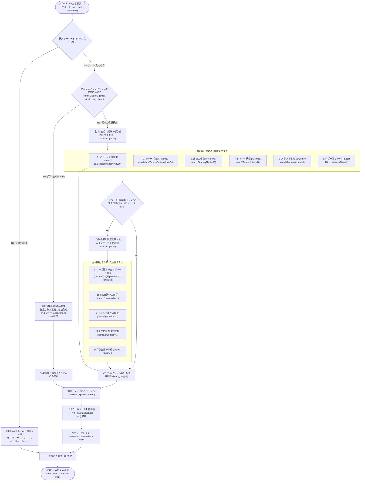

# jelly2iina 検索ロジック仕様書 (Search Engine Specification)

本書は、`jelly2iina` における検索機能の内部アーキテクチャ、処理フロー、API連携、ソート仕様、およびキャッシュ設計を詳細にまとめたドキュメントです。

---

## 1. 概要と設計思想

Jellyfinの標準検索API（`/Items?searchTerm=...`）は、**アイテムの「タイトル名（Name / CleanName / SortName）」に対する部分一致検索**に限られます（ファイル名や概要文はJellyfin APIの検索対象には含まれません）。そのため、以下のようなユースケースで直感的な結果が得られない課題がありました：

- **シリーズ名検索時のエピソード展開**: 「タモリ倶楽部」や「まちカドまぞく」などのシリーズ名（番組名）で検索した際、各話（エピソード動画）のタイトルにシリーズ名が含まれていないとエピソードがヒットしない。
- **出演者・声優・監督検索**: タイトルに出演者名が含まれていない作品（出演者メタデータに登録されている作品）がヒットしない。
- **タグ・スタジオ・ジャンル検索**: メタデータ分類されている作品がフリーワード検索でヒットしない。
- **大規模シリーズの切り捨て**: 長寿番組（200話以上）のエピソードがAPI上限により途中で途切れてしまう。

`jelly2iina` では、単一の検索窓にキーワードを入力するだけで、**「タイトル（動画名）」「シリーズ」「出演者」「ジャンル」「スタジオ」「タグ」の6つのメタデータを同時並行で横断検索**し、関連する全エピソード・動画を漏れなく集約・ソートして返却するハイブリッド検索エンジンを採用しています。

---

## 2. 検索処理の全体フローチャート



---

## 3. 明示的プレフィックス検索 & 複合AND検索 (Explicit Filter & AND Search)

検索窓にプレフィックスを指定することで、特定のメタデータ種別のみを直接検索し、無駄なリクエストを抑えて高速かつ正確に絞り込むことができます。

### ① 利用可能なプレフィックス構文

| プレフィックス | 検索対象 | 動作詳細 |
|---|---|---|
| `lib:<語句>` / `library:<語句>` | **ライブラリ** | 指定されたライブラリ（Anime, TVshow, GAME等）の配下動画を展開。`-lib:game` で特定ライブラリの除外も可能。 |
| `item:<語句>` | **動画タイトル直接** | タイトル（Name）のみを `/Items?searchTerm=...` で検索。シリーズ展開や人物展開を行わない直接APIモード。 |
| `series:<語句>` | **シリーズ名（番組名）** | 指定シリーズを検索し、配下の**全エピソードを一括展開**。他の1次検索（人物・ジャンル等）はスキップ。 |
| `actor:<語句>` | **出演者・キャスト・声優** | 人物を検索し、その人物が出演している作品・エピソードのみを展開。 |
| `genre:<語句>` | **ジャンル** | ジャンル名を検索し、該当ジャンルに属する動画を展開。 |
| `studio:<語句>` | **制作スタジオ・配給** | スタジオ名を検索し、該当スタジオの制作動画を展開。 |
| `tag:<語句>` | **タグ** | タグキャッシュから一致するタグを抽出し、該当動画を展開。 |
| `limit:<数値\|all>` / `max:<数値\|all>` | **取得上限オーバーライド** | 内部検索のアイテム取得上限（既定値: 2000件）を動的に引き上げまたは緩和。例: `limit:5000`, `limit:all` (最大10000件安全ガード)。 |

### ② 複合AND検索 & NOT検索の仕様と動作ルール

スペース区切りで複数の条件を指定すると、**すべての条件を満たす動画のみがヒットするAND検索（アイテムIDの積集合）** として動作します。さらに先頭に `-` を付けることで除外条件（NOT検索・差集合）を適用できます。

1. **スペースを含む語句のクォート対応**:
   スペースを含む値（英語名やサブタイトル等）はダブルクォートで囲むことができます（Python の `shlex.split` に準拠）。
   * 例: `series:"機動戦士ガンダム UC" actor:内山昂輝`
2. **プレフィックスなし単語の自動解釈**:
   プレフィックスが指定されていない単語は自動的に `item:<単語>`（タイトル直接検索）として解釈され、エラーにならずシームレスにAND結合されます。
   * 例: `actor:タモリ レシピ` ➔ 「タモリが出演」かつ「タイトルにレシピを含む」動画を抽出。
3. **`-` によるNOT除外検索（差集合演算）**:
   プレフィックスまたは単語の先頭に `-` を付与することで、**その条件に一致するアイテムを除外**します。
   * 例: `series:タモリ倶楽部 -item:レシピ` ➔ タモリ倶楽部の中からタイトルに「レシピ」を含む回（2話）を除外し、残りの220話を抽出。
   * 例: `genre:アニメ -tag:ホラー` ➔ アニメジャンルからホラータグ作品を除外。
   * 例: `actor:タモリ -item:最終回` ➔ タモリ出演作から最終回を除外。
   * 例: `-item:レシピ` （NOT条件のみ指定時）➔ ライブラリ全件（最大500件）をベース集合とし、そこから除外条件を引いて返却。
4. **シリーズと出演者の組み合わせ（エピソード展開AND）**:
   * 例: `series:機動戦士ガンダム actor:古谷徹`
     * `series` 検索でガンダムシリーズの全エピソードを取得。
     * `actor` 検索で古谷徹の出演作品を取得。
     * 両者の積集合を取ることで、**「ガンダムというシリーズに属し、かつ古谷徹が出演しているエピソード」** のみが厳密に抽出されます。
5. **完全後方互換性**:
   入力されたクエリ内にプレフィックスや `-` が1つも含まれない場合（例: `タモリ倶楽部` や `ガンダム`）は、**従来の6系統一括横断検索がそのまま実行**されます。

---

## 4. 横断検索モード (キーワード指定・プレフィックスなし時) の詳細

エンドポイント: `GET /api/search?q={query}&sort={sort}&limit={limit}&startIndex={startIndex}`

### Step 1: ユーザーIDの解決
各アイテムのユーザー個別データ（`UserData.Rating`: 個人評価 💕、視聴済みステータス、再生位置など）を取得するため、リクエストに `userId` を付与します。
- 環境変数 `JELLYFIN_USER_ID` が設定されていればそれを優先。
- 未設定の場合は `/Users` API を叩き、管理者ユーザー（`IsAdministrator: true`）または先頭のユーザーIDを自動取得して600秒間キャッシュします。

### Step 2: 1次検索（6系統の並列クエリ）
`asyncio.gather` を使用し、以下の6つのクエリを Jellyfin サーバーへ同時並行で送信します：

| # | 対象種別 | Jellyfin API エンドポイント | パラメータ | 役割 |
|---|---|---|---|---|
| 1 | **直接アイテム** | `GET /Items` | `searchTerm={q}`, `includeItemTypes=Movie,Episode,Video`, `limit=2000` | タイトル名（Name）にキーワードが含まれる動画を直接取得 |
| 2 | **シリーズ** | `GET /Items` | `searchTerm={q}`, `includeItemTypes=Series`, `limit=50` | キーワードに一致する番組・アニメ・ドラマのシリーズ本体を検索 |
| 3 | **出演者** | `GET /Persons` | `searchTerm={q}`, `limit=30` | キャスト・声優・監督等の人物情報を検索し Person ID を取得 |
| 4 | **ジャンル** | `GET /Genres` & `GET /Items?genres={q}` | `searchTerm={q}`, `limit=20` / `genres={q}` | ジャンルID検索に加え、手動追加・カスタムジャンル用のジャンル名直接検索 |
| 5 | **スタジオ** | `GET /Studios` | `searchTerm={q}`, `limit=30` | アニメ制作会社・映画配給会社等を検索し Studio ID を取得 |
| 6 | **タグ** | キャッシュ突き合わせ | （内部キャッシュ `/Items/Filters2`） | 全タグ一覧から部分一致するタグ名を抽出 |

> **注意: Jellyfin API における検索対象フィールドと複数キーワードの扱い**:
> - **検索対象フィールド**: Jellyfin の `searchTerm` パラメータはアイテムの「タイトル名（Name / CleanName / SortName）」のみを対象とします。ファイル名（Path）やあらすじ（Overview）は Jellyfin API の検索対象に含まれません。
> - **スペース区切りの扱い**: スペース区切りで複数単語を入力した場合でも、AND検索（条件絞り込み）には分解されず、スペースを含んだ「ひとまとまりの連続文字列」として Jellyfin 側に渡されます（そのため、「シリーズ名 エピソード名」などの組み合わせ検索は現状 0 件になります）。

### Step 3: 2次検索（関連動画の並列展開）
1次検索でヒットしたIDやタグを元に、さらに `asyncio.gather` で関連動画を一括展開します：

1. **シリーズ配下のエピソード取得 (`GET /Shows/{sid}/Episodes`)**:
   - ヒットした各シリーズIDに対してエピソード一覧を取得します。
   - **重要仕様**: ここには `limit` を設定せず、**全エピソードを一括取得**します。これにより、200話以上ある長寿番組（例: タモリ倶楽部、サザエさん等）でも最終回まで欠落なく完全に展開されます。
2. **出演者作品の取得 (`GET /Items?personIds=...&limit=2000`)**:
   - ヒットした人物IDの出演作を一括展開します。
3. **ジャンル所属作の取得 (`GET /Items?genreIds=...&limit=2000`)**
4. **スタジオ制作作の取得 (`GET /Items?studioIds=...&limit=2000`)**
5. **タグ所属作の取得 (`GET /Items?tags=...&limit=2000`)**

### Step 4: 結果の集約と重複排除
すべての結果は `items_map: Dict[str, Any]`（キー: JellyfinアイテムID）に格納されます。
- 同一の動画が「タイトル一致」「シリーズ展開」「出演者一致」の複数にヒットした場合でも、辞書キーによって**完全かつ安全に重複排除**されます。
- 対象メディア種別を `Movie`, `Episode`, `Video` に絞り込みます（FolderやSeries本体のレコードは除外）。

### Step 5: 自然順ソート (Human Natural Sort)
集約された全アイテム配列（`all_items`）に対し、指定されたソート順に応じた並び替えを適用します。

#### 自然順ソートアルゴリズム (`natural_sort_key`)
文字列内の数字部分を正規表現 `re.split(r'(\d+)', s)` で分割し、数値を整数として比較します。
```python
def natural_sort_key(s: str):
    return [int(text) if text.isdigit() else text.lower() for text in re.split(r'(\d+)', s or "")]
```
これにより、辞書順比較で起こりがちな「`Episode 1`, `Episode 10`, `Episode 2`」という不自然な並びが解消され、「`Episode 1`, `Episode 2`, ..., `Episode 10`」と人間が期待する順序で整然と並びます。

#### 提供されているソートオプション一覧
| ソートキー (`sort`) | 表示名 | ソートロジック（メモリ内） | 特徴 |
|---|---|---|---|
| `premiere_desc` (既定) | 📅 公開日 (新しい順) | `PremiereDate` 降順 ➔ `DateCreated` 降順 | 未設定作品は追加日時フォールバックで末尾に配置 |
| `premiere_asc` | 📅 公開日 (古い順) | `PremiereDate` 昇順 ➔ `DateCreated` 昇順 | 古い作品から順に鑑賞する際に便利 |
| `date_desc` | 🕒 追加日 (新しい順) | `DateCreated` 降順 | 最近サーバーに追加された順 |
| `date_asc` | ⏳ 追加日 (古い順) | `DateCreated` 昇順 | 最も古い追加データ順 |
| `user_rating_desc` | 💕 個人評価 (高い順) | `UserData.Rating` (未設定は `-1.0`) 降順 | 自分がつけた星・点数スコア順 |
| `user_rating_asc` | 💕 個人評価 (低い順) | `UserData.Rating` (未設定は `999.0`) 昇順 | 評価の低い順、未設定は末尾 |
| `rating_desc` | ⭐ コミュニティ評価 (高い順) | `CommunityRating` (未設定は `-1.0`) 降順 | TMDb/外部メタデータの共有スコア順 |
| `rating_asc` | ⭐ コミュニティ評価 (低い順) | `CommunityRating` (未設定は `999.0`) 昇順 | 共有スコアの低い順 |
| `filename_asc` | 📁 ファイル名 (昇順) | `get_filename_sort_key` 自然順 昇順 | ファイル名に含まれる話数規則でシリーズが第1話〜最終話順に並ぶ |
| `filename_desc` | 📁 ファイル名 (降順) | `get_filename_sort_key` 自然順 降順 | 最終話から逆順に並ぶ |
| `name_asc` | 🔤 タイトル (A-Z) | `Name` (作品タイトルそのもの) 自然順 昇順 | エピソードの純粋な題名五十音・アルファベット順 |
| `name_desc` | 🔠 タイトル (Z-A) | `Name` 自然順 降順 | タイトル逆順 |
| `random` | 🎲 ランダム | `random.Random(search_term).shuffle(all_items)` | 検索語でシード固定された決定論的ランダム（ページ繰りしても順序が崩れない） |

> **📁 ファイル名順 と 🔤 タイトル順 の使い分け**:
> - **📁 ファイル名順**: ファイル名（例: `[Anime] Title S01E01.mp4`）にシリーズ名と話数番号が含まれることが多いため、**シリーズ作品を第1話から最終話まで整然とグループ化して観たい場合**に最適です。
> - **🔤 タイトル順**: 純粋に動画のタイトル名（例: `「あすへの決意!!」`）の五十音順で探したい場合に最適です。

### Step 6: ページネーションとスライシング
ソート済みの配列 `all_items` から、指定された `startIndex` から `limit` 件（通常40件）をスライスします：
```python
total_record_count = len(all_items)
items = all_items[startIndex: startIndex + limit]
```

---

## 5. 直接APIモード (キーワード未指定・全件一覧時) の動作

検索窓が空欄のときは、全件データを高速かつ無限スクロールで効率的にブラウズするため、Python側での全展開を行わず、**Jellyfinサーバー側のクエリAPI（`/Items`）に直接委譲**します。

### リクエストパラメータ構造
```python
params = {
    "recursive": "true",
    "includeItemTypes": "Movie,Episode,Video",
    "fields": base_fields,
    "sortBy": sort_field,       # SORT_CONFIG から取得した Jellyfin ソートキー
    "sortOrder": sort_order,     # Ascending または Descending
    "limit": limit,              # 40件
    "startIndex": startIndex,    # 0, 40, 80, ...
    "userId": user_id            # 個人評価・視聴ステータス取得用
}
```

### ソートキーのマッピング設定 (`SORT_CONFIG`)
Jellyfin API の `sortBy` / `sortOrder` パラメータに対応するマッピング表です：

| `jelly2iina` のソートキー | Jellyfin `sortBy` | Jellyfin `sortOrder` |
|---|---|---|
| `premiere_desc` | `PremiereDate,DateCreated` | `Descending` |
| `premiere_asc` | `PremiereDate,DateCreated` | `Ascending` |
| `date_desc` | `DateCreated` | `Descending` |
| `date_asc` | `DateCreated` | `Ascending` |
| `user_rating_desc` | `Rating` | `Descending` |
| `user_rating_asc` | `Rating` | `Ascending` |
| `rating_desc` | `CommunityRating` | `Descending` |
| `rating_asc` | `CommunityRating` | `Ascending` |
| `filename_asc` | `SortName` | `Ascending` |
| `filename_desc` | `SortName` | `Descending` |
| `name_asc` | `SortName` | `Ascending` |
| `name_desc` | `SortName` | `Descending` |
| `random` | `Random` | `Ascending` |

---

## 6. データ整形とレスポンス仕様

Jellyfinから取得したアイテムデータ（DTO）は、フロントエンドでの描画やダイレクト再生プレイヤー連携に必要な情報へと正規化されます。

### 返却オブジェクトの構造
```json
{
  "total": 222,
  "startIndex": 0,
  "limit": 40,
  "items": [
    {
      "id": "011c5017e8a8ce1550a0288ab4574cad",
      "name": "巷の皆さん間違ってますよ! タモリ流○○レシピを訂正しよう【最終回】",
      "series_name": "タモリ倶楽部",
      "episode_badge": "S1:E222",
      "type": "Episode",
      "path": "/Volumes/Media/Variety/タモリ倶楽部/タモリ倶楽部 S01E222.mp4",
      "server_os": "linux",
      "stream_url": "http://192.168.1.100:8096/Videos/.../stream?static=true&api_key=...",
      "iina_file_url": "iina://weblink?url=file:///Volumes/Media/...",
      "iina_stream_url": "iina://weblink?url=http://...",
      "mpv_file_url": "mpv-handler://play/<Base64EncodedPath>",
      "mpv_stream_url": "mpv-handler://play/<Base64EncodedStreamUrl>",
      "has_image": true,
      "runtime": "24分",
      "rating": 7.5,
      "user_rating": 9.0,
      "premiere_date": "2023-03-31",
      "tags": ["バラエティ", "料理"],
      "actors": ["タモリ"],
      "studios": ["テレビ朝日"],
      "year": 2023,
      "overview": "40年半の歴史に幕..."
    }
  ]
}
```

### 再生URL生成ルール
1. **Mac IINA用ローカルパスURL (`iina_file_url`)**:
   - `file:///Volumes/...` 形式をURLエンコードし、`iina://weblink?url=file%3A%2F%2F...` スキームを生成。
2. **Mac IINA用ストリームURL (`iina_stream_url`)**:
   - Jellyfin Direct Stream URLを `iina://weblink?url=http%3A%2F%2F...` でラップ。
3. **Windows MPV用URL (`mpv_file_url` / `mpv_stream_url`)**:
   - パスまたはストリームURLをURLセーフなBase64エンコードし、`mpv-handler://play/<Base64>` スキームを生成。
4. **自動判定 (`server_os`)**:
   - Jellyfin サーバーの `ProgramDataPath` や `Path` のスラッシュ/バックスラッシュを検査し、WindowsサーバーかLinuxサーバーかを自動判定。

---

## 7. キャッシュ機構とパフォーマンス設計

1. **タグ一覧キャッシュ (`cached_tags`)**:
   - `/Items/Filters2` の取得結果をメモリ内に保持（TTL: 600秒）。
   - 検索ワード入力のたびにタグAPIを叩くオーバーヘッドを削減。
2. **サーバーOS判定キャッシュ (`detected_server_os`)**:
   - `/System/Info` によるOS判定結果をメモリ内に保持（TTL: 600秒）。
3. **ユーザーID解決キャッシュ (`cached_user_id`)**:
   - `/Users` から取得したアクティブ管理者IDを保持（TTL: 600秒）。
4. **非同期HTTPクライアント (`httpx.AsyncClient`)**:
   - FastAPIのライフサイクルイベント（`lifespan`）で単一クライアントインスタンスを接続プール管理（コネクション再利用、タイムアウト15秒）。
5. **フロントエンドのデバウンス処理**:
   - 検索入力欄へのタイピング時、350msのデバウンスタイマーを適用して無駄な連続APIリクエストを防止。

---

## 8. クライアントサイド・ファセット絞り込みフィルター (In-Memory Faceted Filtering)

検索結果が返却された後、Jellyfinへの再問い合わせ（APIリクエスト）を行わずに、**手元に取得した全アイテムデータをブラウザ上で即座に絞り込むクライアントサイド・ファセットフィルター機能**を実装しています。

### 設計と動作フロー
1. **検索時の一括返却 (`limit=0`)**:
   - 検索クエリ（`q`）が入力された際、フロントエンドはバックエンドAPIに対して `limit=0` を指定し、集約済みの検索結果（`all_items`）を一度に全件取得します。
   - キーワード未指定時（全件ブラウズ時）は、従来通り Jellyfin サーバーに直接委譲する40件単位の無限スクロールを維持します。
2. **動的ファセット生成 (`buildFilterFacets`)**:
   - 取得した全アイテムのメタデータを解析し、以下の6系統のファセットピル（件数バッジ付き）を自動生成します：
     - **📚 ライブラリ (Libraries)**: `ANIME`, `TVshow`, `GAME` 等（`/Library/VirtualFolders` のパス照合により自動解決）
     - **📁 種別 (Types)**: `Episode`, `Movie`, `Video` 等
     - **📅 年代 (Years)**: 公開年（降順）
     - **🎭 ジャンル (Genres)**: 件数上位順
     - **🏷️ タグ (Tags)**: 件数上位順
     - **👤 出演者 (Actors)**: 件数上位順
3. **多い項目の折りたたみ・展開（Expand / Collapse）**:
   - 出演者やタグなど、選択肢が多いカテゴリは初期表示を上位6〜8件に抑制し、末尾に「`+ 他 N 件`」ボタンを配置。
   - ボタンをクリックすると残りの候補がスムーズに展開され、「`▲ 閉じる`」で折りたためます。選択中のピルがある場合は隠れずに確実に保持されます。
4. **ハイブリッド検索条件（OR結合 & AND結合）**:
   - **同一グループ内**: 複数選択時は **OR結合**（例: タグ「料理」または「バラエティ」のいずれかを含む）。
   - **異なるグループ間**: **AND結合**（例: ライブラリ「TVshow」かつ 種別「Episode」かつ タグ「料理 OR バラエティ」）。
   - これにより、jelly2iina のプレフィックスAND検索（積集合）では難しかった「広めに検索して、手元で複数タグのOR絞り込みを行う」ユースケースが完全に実現します。
5. **クライアント無限スクロール (Chunking Render)**:
   - 絞り込み後のアイテムは手元のメモリ内で管理され、初期40件を描画。下にスクロールすると手元データから次の40件をスライシングして追加描画するため、DOM描画が極めて軽量かつスムーズに保たれます。
6. **開閉とリセット**:
   - フィルターセクションは開閉（アコーディオン）が可能。
   - 「✕ フィルター全解除」ボタンで瞬時に条件クリア。
   - 検索キーワードのクリア時（`clearBtn`）は、フィルターセクション自体が自動的に非表示になり、初期表示へ戻ります。

---

## 9. 内部取得上限のチューニングと上限到達通知 (Fetch Limit Tuning & Alerts)

サーバーの安定性とレスポンス速度を担保するため、Jellyfin 内部APIへの問い合わせ上限には安全なデフォルト値（2,000件）が設定されていますが、開発者や特別な検証、全件網羅が必要なケースに対応するための柔軟な緩和機構を備えています。

### 1. 環境変数による既定値の設定 (`.env`)
- `SEARCH_INTERNAL_FETCH_LIMIT`: 通常検索時の内部取得上限（未指定時は `2000`）。
- `SEARCH_MAX_FETCH_LIMIT`: `limit:all` 指定時や手動引き上げ時にサーバークラッシュを防ぐ絶対安全ガード（未指定時は `10000`）。

### 2. クエリプレフィックスによる一時オーバーライド (`limit:N` / `limit:all`)
検索窓に以下のように入力することで、その検索リクエストのみ内部上限を動的に変更できます：
- `lib:anime limit:5000`: ANIMEライブラリの中から最大5,000件まで取得。
- `series:ガンダム limit:all`: 最大安全値（10,000件）まで一気に取得。

### 3. 上限到達時のプロアクティブUI（上限解除ボタン）
検索結果が現在の内部取得上限（2,000件等）に達した場合、検索結果件数表示の横に警告バッジが表示されます：
> `2,000 / 2,000 件表示中  ⚠️ 取得上限 (2,000件) に達しました [上限解除 (全件取得)]`

この「**上限解除 (全件取得)**」ボタンをクリックすると、検索窓のクエリに自動で `limit:all` がセットされて再検索が実行され、最大安全上限（10,000件）までシームレスに取得が拡張されます。
